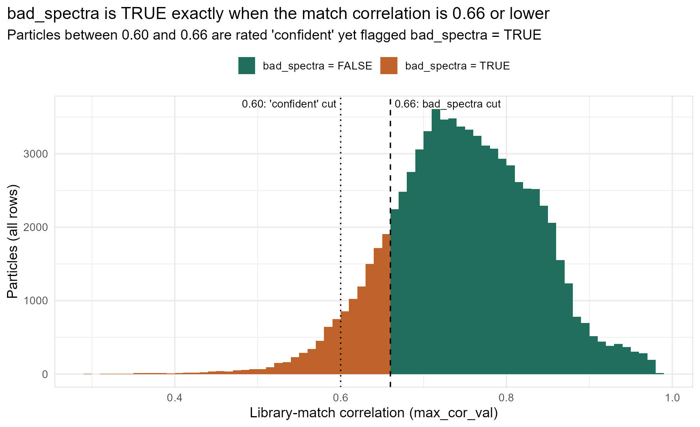
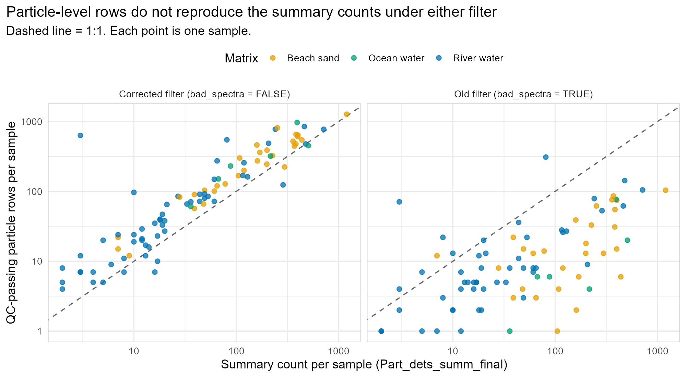
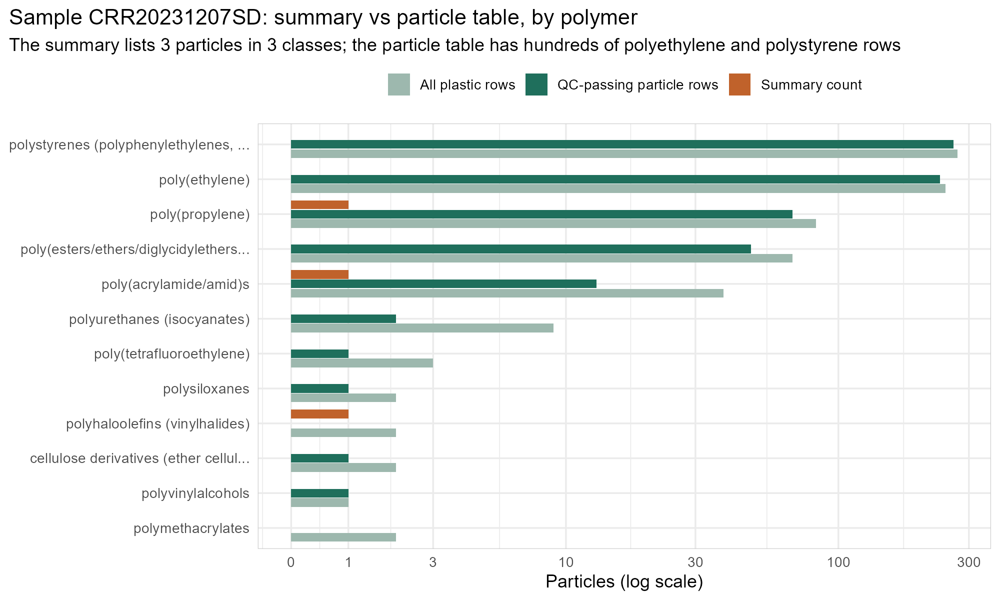
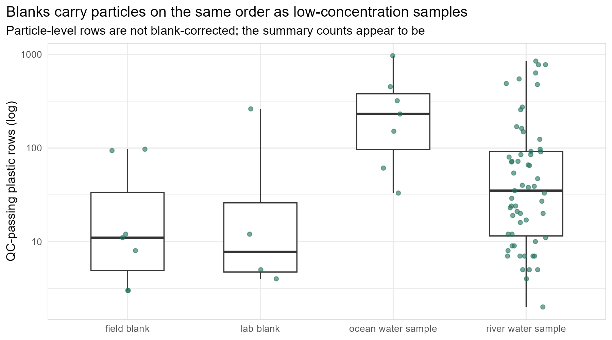
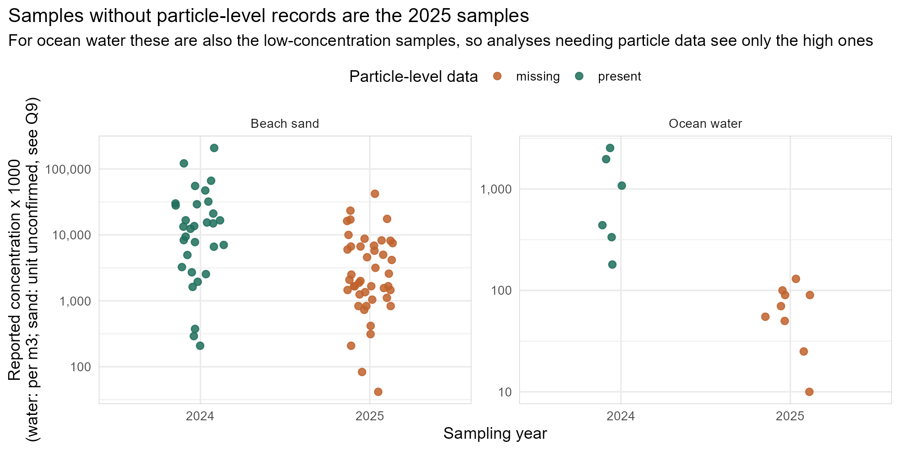
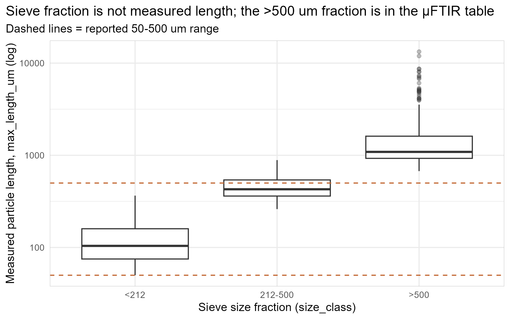
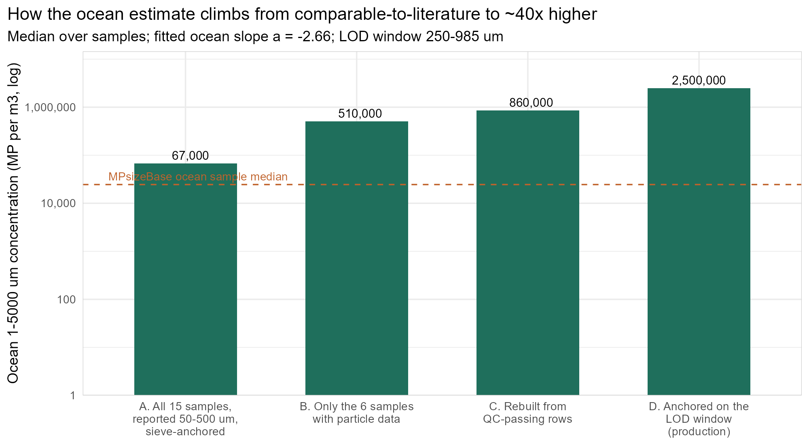

# Questions for the analytical lab: particle-level data, QC flags and counts

**Project:** Savoca et al., W2W Monterey Bay rivers microplastics
**From:** Scott Coffin (OEHHA); analysis repository [mssavoca/W2W_river_plastics](https://github.com/mssavoca/W2W_river_plastics)
**For:** the Moore Institute analysts and the project team
**Prepared:** 15 October 2026
**Data examined:** `data_input/Part_dets_comb.rds` (particle-level µFTIR export, file dated 27 Jan 2026) and `data_input/Part_dets_summ_final.rds` (per-sample summary, dated 14 Oct 2026)

Each numbered question (Q1–Q14) has a matching GitHub issue (#5–#18, label `lab-data`) so it can be answered and closed individually. Figures are regenerated by `Rscript tools/lab_question_figures.R`.

---

## 1. Background: what the analysis does with your data

The risk assessment in this repository (`R/probabilistic_risk_characterization.qmd`) uses the lab data in two ways.

1. **Particle-size distributions (PSDs).** Every QC-passing particle's measured length goes into a cumulative particle-size distribution, fitted with a power law using the Segur et al. (2026) method. The fit only uses a size window where detection looks complete and the distribution is straight on log–log axes. We call this the *LOD window* (for river water it runs roughly 80–535 µm, depending on the river). The fitted slope describes how quickly particle numbers rise as size falls.

2. **Rescaling concentrations to a common size range.** Studies report different size ranges, so concentrations are converted to 1–5000 µm, the range used by the toxicity thresholds. Rescaling multiplies a measured concentration by a correction factor (CF) that integrates the fitted power law from the measured window to 1–5000 µm. Because the power law is steep, most of the rescaled count comes from extrapolation below the smallest measured particles. The CF is very sensitive to the slope and to the window it starts from.

For the rescaling to be valid, **the concentration and the CF must describe the same particles in the same size window.** We take each sample's concentration from your summary file and the in-window share from your particle file, so the two files have to agree on which particles exist. This document is about where they do not agree.

### Key terms

| Term | Meaning here |
|---|---|
| Summary file | `Part_dets_summ_final.rds`: one row per sample × polymer class, with `count`, `extrap_count`, `sample_prop` and the reported concentration `extrap_conc_PPL` (50–500 µm) |
| Particle file | `Part_dets_comb.rds`: one row per imaged particle, with size, shape, polymer match, `max_cor_val`, `acc_analy_conf` and `bad_spectra` |
| QC-passing particle | `acc_analy_conf == "confident"` and `bad_spectra == FALSE` (see Q1, Q2) |
| LOD window | Size range where the fitted PSD is valid (Segur et al. 2026 algorithm) |
| CF | Correction factor that rescales a concentration from a measured window to 1–5000 µm |
| Rebuilt concentration | QC-passing particle rows in a window × (`extrap_count` / `count`) ÷ sample volume |

### What changed recently, and why we are asking now

- **A polarity error in our spectral filter.** Our pipeline kept particles with `bad_spectra == TRUE`, assuming TRUE meant a good spectrum. The data show TRUE means the match correlation is 0.66 or lower (Figure 1). We were therefore fitting slopes on the *poorly* matched particles only (1,195 of 7,148 QC-passing river particles). The filter now keeps `bad_spectra == FALSE`. This changes every slope and concentration.
- **A provisional change to how concentrations are built.** Concentrations are now rebuilt from QC-passing particle rows scaled by your aliquot factor, rather than taking your reported concentration and multiplying it by the in-window share. We flagged this as needing your confirmation before publication, because it depends on what the particle rows represent (Q3–Q8).
- **An unexpectedly high ocean estimate.** After these changes, our rescaled ocean concentrations came out about 40 times higher than the global MPsizeBase compilation. On identical measured size windows, Monterey Bay sits inside the literature range. Section 3 traces the gap to data-handling choices that only you can settle.

---

## 2. What we found in the data

### 2.1 `bad_spectra` is a cut on the match correlation

*Figure 1. Library-match correlation for all particles. Every particle at or below 0.66 has `bad_spectra = TRUE`; every particle above has FALSE, with no exceptions in 77,299 rows. The analyst rating "confident" starts at 0.60, so particles between 0.60 and 0.66 are "confident" but still flagged bad.*

### 2.2 The particle file does not reproduce the summary counts

*Figure 2. QC-passing particle rows per sample vs the summary `count`. Under the corrected filter (left), the particle file has about 1.9 times as many particles as the summary for river samples (7,148 vs 3,777). Under the old filter (right), it has about a third. Neither lines up with the 1:1 line sample by sample.*

*Figure 3. One river sample, polymer by polymer. The summary lists 3 particles (one each of polypropylene, polyamide and PVC). The particle file holds 729 plastic rows (634 QC-passing), dominated by polystyrene and polyethylene, the same polymers that dominate the blanks (Figure 6). Across river samples, 87 sample × polymer cells have a summary count larger than every plastic row of that polymer, and 133 cells have particles but no summary count. The summary is not a filtered subset of the particle file.*

### 2.3 Blanks are not removed from the particle file

*Figure 6. QC-passing plastic particle rows per blank and per sample. Field blanks hold a median of 11 particles (maximum 97) and lab blanks up to 262, mostly polyethylene. For a 200 L sample, 11 particles is about 55 particles per m³, comparable to an entire low-concentration ocean sample. The summary counts appear to be blank-corrected; the particle rows are not.*

### 2.4 Many recent samples have no particle-level records

*Figure 4. Reported concentrations for ocean water and beach sand by year, coloured by whether the sample has particle-level records. The particle file predates the 2025 samples: 1 river, 9 of 15 ocean and 45 of 75 beach-sand samples have no particle rows. For ocean water, the missing samples are also the low-concentration ones.*

### 2.5 Sieve fractions and size ranges

*Figure 7. `size_class` holds sieve fractions, not measured length: the &lt;212 µm fraction contains particles up to 359 µm long. The &gt;500 µm fraction is present in the µFTIR particle file (111 QC-passing river particles, 698–11,943 µm), although the methods describe a separate stereomicroscope analysis for 500–5000 µm.*

---

## 3. Why the ocean estimate is so high

*Figure 5. The ocean 1–5000 µm estimate step by step (medians over samples, fitted ocean slope). Starting from all 15 samples' reported 50–500 µm concentrations, the estimate (about 67,000 per m³) is comparable to MPsizeBase (dashed line, sample median about 25,000; fragment PSDs about 51,000). Three steps raise it to the production value of about 2.5 million per m³.*

1. **Sample selection (×7.6).** Only the 2024 ocean samples have particle data, and they are the high ones (reported 180–2,540 per m³). The 2025 samples (10–130 per m³) drop out of any analysis that needs particle rows. → Q10
2. **Rebuild basis and blanks (×1.7).** The particle rows outnumber the summary counts and are not blank-corrected. → Q3, Q4
3. **Anchor and extrapolation (×2.8).** With the corrected filter, the ocean fit window moved up to 250–985 µm. It holds 21% of the 50–500 µm particles where the fitted power law predicts 6.4%, so the measured distribution is flatter than the fitted slope at the small end. Rescaling from the upper window then puts 98% of the 1–5000 µm count below 10 µm. → Q6, Q14

The report computes this decomposition live (Section 13.6, subsection D6). The same mechanisms affect river water, more mildly: the rebuilt river concentration is about 1.85 times the reported one.

---

## 4. Questions

### Spectral QC flags

**Q1 ([#5](https://github.com/mssavoca/W2W_river_plastics/issues/5)). What does `bad_spectra` mean?**
- *We see:* `bad_spectra` is TRUE exactly when `max_cor_val` ≤ 0.66 (Figure 1). Every "possible" or "undetermined" particle is TRUE.
- *Question:* Please confirm that TRUE means the spectrum failed quality control. Is 0.66 your acceptance threshold? Which software, library and version produce `max_cor_val`?
- *Resolves it:* A one-line definition and the threshold.

**Q2 ([#6](https://github.com/mssavoca/W2W_river_plastics/issues/6)). How is `acc_analy_conf` assigned, and how does it combine with `bad_spectra`?**
- *We see:* "confident" spans `max_cor_val` 0.600–0.983, "possible" 0.315–0.600, and one particle is "undetermined". 8,195 particles are "confident" but flagged bad (0.60–0.66).
- *Question:* Is the confidence rating an automatic threshold or an analyst review? Which combination of the two flags defines a particle counted in the reported totals?
- *Resolves it:* The inclusion rule used to build `count` in the summary file.

### Particle file vs summary counts

**Q3 ([#7](https://github.com/mssavoca/W2W_river_plastics/issues/7)). How is the summary `count` derived from the particle records?**
- *We see:* 3,777 summary particles vs 7,148 QC-passing rows for the 57 river samples; summary cells that exceed the particle rows, and particle rows with no summary cell (Figures 2, 3).
- *Question:* What steps turn particle records into summary counts? For example: blank subtraction by polymer, LOD/LOQ censoring, polymer reclassification or merging, manual removal after review, or a newer particle export. Please list them in order.
- *Resolves it:* The script or worksheet that builds `Part_dets_summ_final.rds` from `Part_dets_final.rds`. In our copy it is referenced as `../W2W_MBNMS/`, which we do not have.

**Q4 ([#8](https://github.com/mssavoca/W2W_river_plastics/issues/8)). Are the summary counts blank-corrected, and how?**
- *We see:* 16 field blanks (185 particles) and 26 lab blanks (250) in the summary; particle-level blanks with a median of 11 QC-passing particles (Figure 6). 90 of 99 MPsizeBase ocean PSDs are blank-corrected.
- *Question:* Which blanks (field, lab/procedural, air) are matched to which samples? Is correction by polymer, by size class or on the total? Is it subtraction, censoring below a blank-based limit, or flagging only?
- *Resolves it:* A sample-to-blank batch table and the correction rule, so we can blank-correct the particle-level data consistently with your totals.

**Q5 ([#9](https://github.com/mssavoca/W2W_river_plastics/issues/9)). Where do the hand-picked fibers appear?**
- *We see:* The methods say fibers were hand-picked onto slides, counted and measured. In the µFTIR particle file, 17.7% of QC-passing river particles are fibers by our shape rule (aspect ratio ≥ 3).
- *Question:* Are the hand-picked fibers in the particle file, the summary, both, or neither? Could fibers be double-counted or omitted?
- *Resolves it:* Which file each fiber count lives in, plus any separate fiber data.

**Q6 ([#10](https://github.com/mssavoca/W2W_river_plastics/issues/10)). How do the sieve fractions relate to the reported 50–500 µm range?**
- *We see:* Figure 7. The &gt;500 µm fraction is in the µFTIR file; `size_class` labels use two encodings ("um" and "µm").
- *Question:* Is the &gt;500 µm µFTIR fraction counted in the reported concentration, in the visual 500–5000 µm data, or both? Were the fractions analysed with different aliquot proportions?
- *Resolves it:* Which fractions feed each reported number.

### Aliquots, runs and volumes

**Q7 ([#11](https://github.com/mssavoca/W2W_river_plastics/issues/11)). What exactly are `count`, `extrap_count` and `sample_prop`?**
- *We see:* `extrap_count / count = 1 / sample_prop` for every sample. Some samples carry several `sample_prop` values: SLR20240122SS (9 values, 0.6–0.8), CRR20250313SD (6), SRR20250403SS (3), SRU20251001S (2).
- *Question:* Is `count` the number identified in the analysed aliquots, and `extrap_count` the whole-sample estimate? Is `sample_prop` a fraction of filter area or of sample volume? With several values, which applies to which particles?
- *Resolves it:* A per-run aliquot fraction joined to the particle file.

**Q8 ([#12](https://github.com/mssavoca/W2W_river_plastics/issues/12)). Should split runs and filter halves be summed?**
- *We see:* Five samples appear as `_1`/`_2` in the particle file but as one ID in the summary (e.g. CRR20231207SS_1 and _2). We sum them. Run names include PreDS/PstDS, "1of3" and lft/rt; one sample has 12 runs.
- *Question:* Are `_1`/`_2` parts of one sample? Were pre- and post-density-separation fractions, and both filter halves, separate parts of a sample, or could a particle be imaged twice?
- *Resolves it:* A run-to-sample map stating which runs add.

**Q9 ([#13](https://github.com/mssavoca/W2W_river_plastics/issues/13)). What volume or mass does each sample represent?**
- *We see:* The implied volume (extrapolated count ÷ concentration) is exactly 200 L for every river and ocean sample, and 24 for every beach-sand sample.
- *Question:* Were all water samples exactly 200 L? What is the unit of 24 for sand (litres of water, or kilograms)? Is a dry sediment mass available?
- *Resolves it:* Measured volume per water sample, and dry mass per sand sample. Without dry mass, sand cannot be expressed per kg and stays out of the headline.

### Missing and mislabelled records

**Q10 ([#14](https://github.com/mssavoca/W2W_river_plastics/issues/14)). Can we get an updated particle-level export?**
- *We see:* Figure 4. Samples with no particle rows: 1 river (SRR20250303SD, 47 particles), 9 of 15 ocean, 45 of 75 beach sand, mostly 2025.
- *Question:* Can you send a current `Part_dets_final.rds` covering every summary sample?
- *Resolves it:* The updated file. This is the single most useful item on this list; it removes the ×7.6 ocean selection effect.

**Q11 ([#15](https://github.com/mssavoca/W2W_river_plastics/issues/15)). Should the "WaterBlank" IDs be blanks?**
- *We see:* PRU20241204_WaterBlank (beach sand, 5 plastic particles, currently in the sand sample set), SLR20240122_WaterBlank and SRR20240205_WaterBlank (river; mineral and organic matter only) are labelled `sample`.
- *Question:* Should these be blanks, and which samples do they correct?
- *Resolves it:* Corrected labels.

**Q12 ([#16](https://github.com/mssavoca/W2W_river_plastics/issues/16)). Was ocean sampling depth recorded?**
- *We see:* `sample_depth_general` is empty for every ocean particle; river samples have surface and subsurface strata.
- *Question:* Were ocean samples surface, subsurface, or integrated?
- *Resolves it:* Depth per ocean sample. It decides which literature depth class we compare against.

### Recovery and measurement definitions

**Q13 ([#17](https://github.com/mssavoca/W2W_river_plastics/issues/17)). Were concentrations corrected for spike recovery?**
- *We see:* The particle file has 2 spike-and-recovery samples; the methods describe one spike per 20 samples (polyethylene, polyolefins, cellulose acetate, PVC).
- *Question:* What were recovery rates by polymer and size, and were reported concentrations recovery-corrected?
- *Resolves it:* The recovery table and whether it was applied.

**Q14 ([#18](https://github.com/mssavoca/W2W_river_plastics/issues/18)). How are length, width and area measured, and is there a size cutoff?**
- *We see:* The shortest recorded length is exactly 50 µm; the FTIR step size is 25 µm. We use `max_length_um` as length and `min_length_um` as width, and estimate thickness from the width:length ratio.
- *Question:* Are length and width Feret diameters or bounding-box sides? Is 50 µm an applied cutoff, and is detection complete from 50 to 100 µm (2–4 pixels)? Are any thickness data available?
- *Resolves it:* Measurement definitions and the cutoff rule.

---

## 5. Processing steps missing from this repository

The repository starts from two already-processed files. These steps happen upstream and are not in the code here; each limits what we can correct or verify.

| Upstream step | What we cannot do without it | Questions |
|---|---|---|
| Script building `Part_dets_final.rds` and `Part_dets_summ_final.rds` (folder `W2W_MBNMS`) | Reproduce or reconcile summary counts from particle records | Q3 |
| Blank correction (blank–sample matching, rule, per polymer or size) | Blank-correct particle-level data so rebuilt concentrations match your totals | Q4, Q11 |
| QC acceptance rule and spectral library version | Confirm which particles count as identified microplastics | Q1, Q2 |
| Per-run aliquot fractions and run-to-sample map | Extrapolate counts correctly when a sample has several runs or fractions | Q7, Q8 |
| Fiber hand-picking and visual &gt;500 µm records | Avoid double counting or omitting fibers and large particles | Q5, Q6 |
| Spike recovery calculation | Report or apply recovery correction | Q13 |
| Sample metadata: measured volumes, sediment dry mass, ocean depth | Express concentrations on the right basis; include sediment | Q9, Q12 |
| Current particle export for 2025 samples | Use all samples, not just the earlier, higher ones | Q10 |

## 6. What we need back, in priority order

1. An updated particle-level export covering every summary sample (Q10).
2. The rule and code that turn particle records into summary counts, including blank correction and the blank–sample batch map (Q3, Q4).
3. Confirmation of the QC flags (Q1, Q2) and of the aliquot and run structure (Q7, Q8).
4. Fiber and large-fraction accounting (Q5, Q6).
5. Sample metadata: volumes, sand dry mass, ocean depth, blank labels, spike recovery (Q9, Q11–Q13).
6. Measurement definitions (Q14).

## 7. Where to look in the repository

- `R/particle_qc_audit.R`: the audit behind Sections 2–3 (polarity, waterfall, per-sample reconciliation, filter-size bias, filter variants). Outputs in `data_output/particle_qc_*.csv`.
- `R/probabilistic_risk_characterization.qmd`, Section 4.2.2.1: spectral QC and particle accounting in the production report.
- `R/mpsizebase_comparison.qmd`, subsection D6: the ocean decomposition and the MPsizeBase comparison.
- `tools/lab_question_figures.R`: regenerates the figures in this document.
